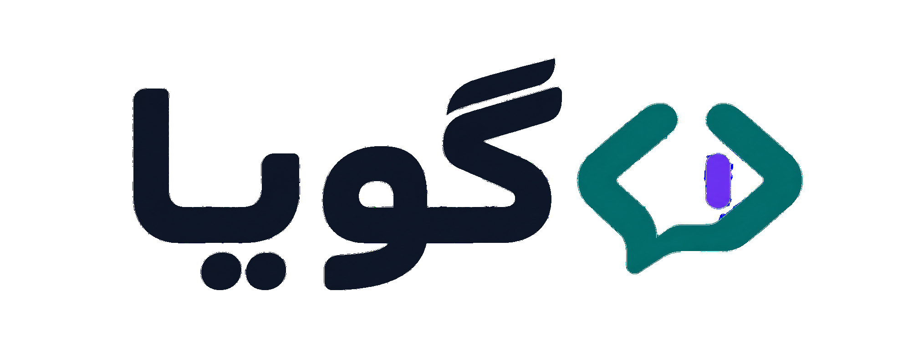
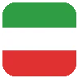
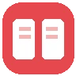

<div align="center">
  
</div>

# گویا (Goya) 

گویا یک زبان برنامه‌نویسی است که کلیدواژه‌ها، اعداد، پیام‌های خطا و تقویمش فارسی‌ان:
`اگر`، `وگرنه`، `تا وقتی که`، `برای هر`، `تابع`، `برگردان` — خروجی با ارقام فارسی،
خطاها با شماره‌ی سطر و خودِ سطر، و `امروز()` که تاریخ شمسی برمی‌گردونه. بدون آکولاد،
بدون سمی‌کالن — بلوک‌ها با تورفتگی مثل پایتون، تا تایپ فارسی راحت بمونه.

نحو و معناشناسی گویا مستقل است: واژه‌ساز، تجزیه‌گر (AST) و ارزیاب خودش را دارد و کد
پایتون را اجرا نمی‌کند (در موتور خبری از `exec` / `eval` / `compile` نیست) — یعنی یک
مفسر واقعی، نه پوسته‌ای روی پایتون.

پیاده‌سازی مفسر با پایتون است (یک زبان میزبان‌شده — مثل Clojure که روی JVM می‌دوه)، فقط
با کتابخانه‌ی استاندارد و بدون هیچ وابستگی بیرونی. همین مفسر با PyInstaller **قابل**
بسته‌بندی به یک فایل اجرایی تک‌فایله است: `export.py` این کار را پیاده کرده، ولی
`goya.exe` هنوز منتشر نشده و در فاز ۳ نقشه‌ی راه است.

##  ویژگی‌ها

- **کلیدواژه‌های فارسی**: `اگر`، `وگرنه`، `تا وقتی که`، `برای هر`، `تابع`، `برگردان`
- **اعداد فارسی و لاتین**: `۱۲۳` و `123` هر دو قبول‌ان؛ خروجی همیشه با رقم فارسی
- **رشته با هر دو گیومه**: `"متن"` یا `«متن»`
- **نرمال‌سازی خودکار**: `ي/ی`، `ك/ک`، نیم‌فاصله، ارقام عربی — همه یکی حساب می‌شن
- **اپراتورهای کلمه‌ای**: `بزرگتر از`، `ضربدر`، `تقسیم بر`، `باقیمانده` (سمبل‌ها هم قبول)
- **تاریخ شمسی توکار**: `امروز()` → تاریخ امروز به شمسی، مثل `۱۴۰۵/۰۷/۲۲`
- **خطاهای فارسی آدم‌فهم** با شماره سطر و نمایش خود سطر

##  محیط گویا (IDE)

یه محیط برنامه‌نویسی فارسی و راست‌چین تو مرورگر خودت — با رنگ‌آمیزی زنده‌ی کد،
قالب‌های آماده (تایپ کن «اگر»، کل ساختار میاد)، پنل ورودی، تم روشن/تیره و دکمه‌ی اجرا:

```bash
python -m goya ide
```

مرورگر خودش باز می‌شه روی `http://127.0.0.1:8765` (تا ۸۷۷۵) — همه‌چیز محلیه، هیچی جایی نمی‌ره.

##  شروع سریع

```bash
python -m goya run examples/salam.goya   # اجرای فایل
python -m goya repl                      # محیط تعاملی
```

```text
گویا> ۲ + ۳ * ۴
=> ۱۴
گویا> بگو(۲ + ۳ * ۴)
۱۴
گویا> تابع مربع(عدد)
   ...     برگردان عدد * عدد
   ...
گویا> مربع(۷)
=> ۴۹
```

در REPL سطرهای بلوک (مثل بدنه‌ی `تابع` و `اگر`) با یک سطر خالی بسته می‌شن.

##  یه نگاه به زبان

```text
## فاکتور خرید — کامنت با ##
خرید = ["نان"، "شیر"، "چای"]

تابع جمع_لیست(لیست)
    جمع = ۰
    برای هر قیمت در لیست
        جمع = جمع + قیمت
    برگردان جمع

اگر طول(خرید) > ۲
    بگو("فاکتور سنگینه: " + متن(جمع_لیست([۱۲۰۰۰، ۴۵۰۰۰، ۸۵۰۰۰])) + " تومان")
وگرنه
    بگو("سبک‌ه")
```

##  کلیدواژه‌ها

| فارسی | کار | مثل |
|--------|-----|-----|
| `بگو` / `بنویس` | چاپ | `print` |
| `بپرس` / `بگیر` | ورودی از کاربر | `input` |
| `اگر` / `وگرنه اگر` / `وگرنه` | شرط | `if / elif / else` |
| `تا وقتی که` | حلقه شرطی | `while` |
| `برای هر x از a تا b` / `در` | حلقه | `for` |
| `تابع` / `برگردان` | تابع | `def / return` |
| `بشکن` / `ادامه` | کنترل حلقه | `break / continue` |
| `درست` / `غلط` / `پوچ` | مقدار | `True / False / None` |
| `و` / `یا` / `نه` | منطق | `and / or / not` |

توابع داخلی: `طول`، `عدد`، `متن`، `گرد`، `تصادفی(از، تا)`، `امروز()` — و برای پنجره: `فرم`، `دکمه`، `برچسب`، `کادر`، `پیام`

نمونه‌ی گرافیکی: [examples/mashin-hesabi-grafiki.goya](examples/mashin-hesabi-grafiki.goya) — یه پنجره‌ی واقعی با دکمه و رویداد

##  گویا چیست و چه چیزی هنوز نیست

**هست:** یک زبان برنامه‌نویسی با گرامر، مفسر و معناشناسی مستقل؛ فارسی از کلیدواژه تا
تقویم؛ همراه با REPL، محیط مرورگری راست‌چین و موتور فرم/رویداد (فرم، دکمه، برچسب، کادر، پیام).

**هنوز نیست:** کامپایلر و ماشین مجازی مستقل؛ کتابخانه‌ی استاندارد کاربردی (اکسل/CSV/HTTP
در فاز ۴ است)؛ و راهی برای `import` کردن کتابخانه‌های پایتون از داخل کد گویا.

##  چرا فارسی — و پیشینه‌اش

بومی‌سازی زبان برنامه‌نویسی یک سنت جاافتاده است، نه یک ایده‌ی تازه:

- **Citrine** (از ۱۹۹۳) بومی‌سازی را اصل کارش گذاشته: کلیدواژه، ارقام و نقطه‌گذاری بومی — «۱۱۰ ویرایش، از گیلیک تا فارسی».
- **Hedy** (زبان آموزشی هلندی، ۲۰۱۹): ۴۷ زبان، از جمله سیستم‌های عددی غیرلاتین، با پیام‌های خطای توضیح‌دهنده.
- **Legesher**: کلیدواژه و استثناهای پایتون را به ۵۱ زبان (از جمله فارسی) ترجمه می‌کند.
- **1C:Enterprise** با کلیدواژه‌های روسی حدود یک‌سوم بازار سازمانی روسیه را گرفته؛ **KuMir** و **Rapira** زبان‌های آموزشی روسی‌اند.
- زبان‌های فارسی‌زبان هم پیش از این بوده‌اند: **زنگار** (Rust با کلیدواژه‌های فارسی) و **کاتی**.

پس گویا «اولین زبان فارسی» نیست و ادعایی هم ندارد؛ ادعایش این است که فارسی را تا ته جدی
بگیرد — حتی به قیمت اینکه کد برای برنامه‌نویس غیرفارسی‌زبان خوانا نباشد. بر پایه‌ی بررسی
نمونه‌های شناخته‌شده، دو چیز را جای دیگری ندیدیم: **تقویم شمسی در سطح خود زبان** و
**نرمال‌سازی متن فارسی** (`ي/ی`، `ك/ک`، نیم‌فاصله).

##  نام و بسته‌ها

نام توزیع پایتونی `goya-lang` است (نه `goya`)، چون خودِ واژه‌ی `goya` در PyPI، npm و
crates.io دست پروژه‌های نامرتبط است. دستور خط فرمان پس از نصب، `goya` است؛ و از ریشه‌ی
پروژه، `python -m goya ...` کار می‌کند.

##  نقشه راه

- **فاز ۱ ✅ (انجام شده)** — مغز زبان: مفسر، REPL، خطاهای فارسی، تست‌ها + **محیط گرافیکی (IDE) راست‌چین**
- **فاز ۲ ✅ (موتور)** — فرم، دکمه، برچسب، کادر، پیام + رویداد کلیک با قرارداد اسم — دسترسی نقطه‌ای: `کادر۱.متن`
- **فاز ۳ — نیمه‌کاره:** طراح بصری فرم (درگ‌ودراپ) ساخته شده (`goya/studio.py`)؛ خروجی `goya.exe` تک‌فایله باقی مانده
- **فاز ۴** — کتابخانه‌های کاربردی (اکسل/CSV/HTTP)؛ سایت مستندات ساخته شده

##  نصب (برای توسعه)

```bash
git clone https://github.com/alizamani1616/goya
cd goya
python -m goya run examples/fizzbuzz.goya
python -m unittest discover -s tests   # مفسر، گرامر، خطاها، کنترل‌های گرافیکی، REPL
```

## English (summary)

**Goya** is a programming language in Persian: Persian keywords, Persian digits,
beginner-friendly Persian error messages, and a built-in Jalali (Shamsi) calendar —
`امروز()` returns today's Persian date. Blocks are indentation-based (no braces, no
semicolons) so Persian typing stays smooth.

It has its own lexer, parser (AST) and evaluator, and the engine never executes Python
source (no `exec`/`eval`/`compile` anywhere) — so it is a self-contained interpreter,
not a wrapper around Python. The implementation is hosted on Python (like Clojure on
the JVM), uses only the standard library, and is MIT-licensed. It can be packaged into
a single-file executable with PyInstaller (`export.py`); a released `goya.exe` is still
on the roadmap (phase 3).

Goya is not a compiler and has no standalone VM yet, and its standard library is still
growing. It is also not the first Persian-language programming language: it belongs to
an established tradition of localized languages (Citrine, Hedy, Legesher, Zangar, Kati).
What it adds is a Persian-first language down to the Jalali calendar and Persian text
normalization.

##  هویت بصری

| رنگ | کد | کاربرد |
|------|-----|--------|
| فیروزه‌ای | `#0F766E` | رنگ اصلی برند و دکمه‌ها |
| بنفش | `#7C3AED` | تأکیدها و عناصر ویژه |
| سرمه‌ای | `#111827` | زمینه تیره و متن در تم روشن |
| سفید یخی | `#F8FAFC` | زمینه روشن و متن در تم تیره |
| فیروزه‌ای روشن | `#2DD4BF` | لینک‌ها و تأکیدها در تم تیره |
| خاکستری روشن | `#CBD5E1` | متن‌های فرعی در تم تیره |

##  لایسنس

MIT — آزاد و رایگان.
